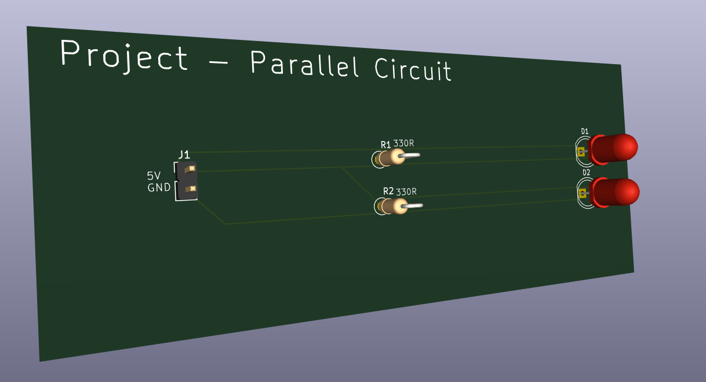
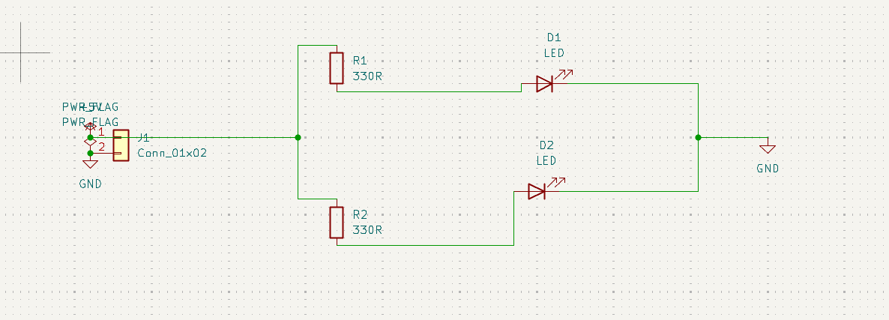
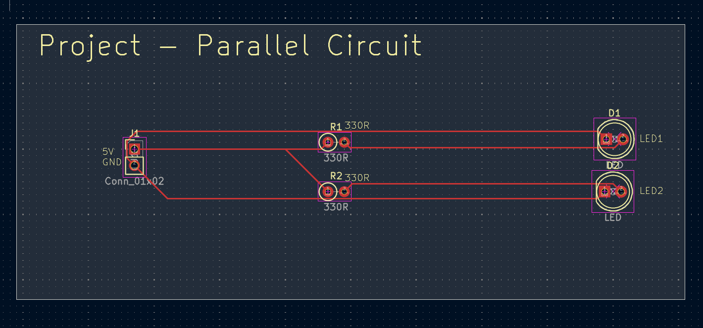
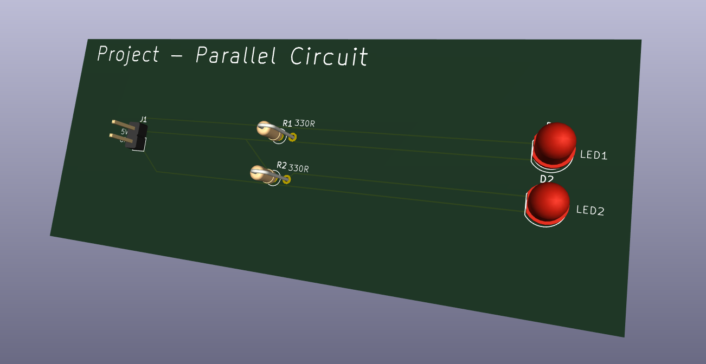

# Project-Parallel-Circuit

A first hands-on KiCad PCB project built to explore a real parallel DC circuit from electrical calculation through schematic capture, footprint assignment, PCB layout, routing, verification, and 3D inspection.

The board uses a 5 V input and two independent LED branches. Each branch contains its own 330 Ω current-limiting resistor and LED, so the resistor/LED pair is series-connected inside the branch while the two complete branches are connected in parallel.



## Circuit architecture

```text
                     Branch 1
              R1 330 Ω        D1
          +---/\/\/\/---------|>|---+
          |                         |
+5 V -----+                         +----- GND
          |                         |
          +---/\/\/\/---------|>|---+
              R2 330 Ω        D2
                     Branch 2
```

Electrical structure:

- J1 pin 1: +5 V input
- J1 pin 2: GND
- Branch 1: +5 V -> R1 -> D1 -> GND
- Branch 2: +5 V -> R2 -> D2 -> GND
- R1 and D1 are in series.
- R2 and D2 are in series.
- The two branches are in parallel.

## Electrical calculations

Design assumptions:

- Supply voltage, `Vs` = 5 V
- Approximate LED forward voltage, `Vf` = 2 V
- Current-limiting resistance per branch = 330 Ω

Voltage across each resistor:

```text
Vr = Vs - Vf
Vr = 5 V - 2 V
Vr = 3 V
```

Approximate branch current:

```text
I = Vr / R
I = 3 V / 330 Ω
I ≈ 0.00909 A
I ≈ 9.1 mA
```

Because the branches are parallel and use the same nominal component values:

```text
I1 ≈ 9.1 mA
I2 ≈ 9.1 mA
Itotal = I1 + I2
Itotal ≈ 18.2 mA
```

Approximate resistor dissipation:

```text
P = Vr × I
P ≈ 3 V × 0.00909 A
P ≈ 0.027 W
```

A 0.25 W resistor rating therefore provides substantial margin for the assumed operating point.

> `Vf = 2 V` is a design approximation. Real LED forward voltage varies with LED type, colour, current, temperature, and manufacturing tolerance, so measured current will differ somewhat from the calculated value.

## Schematic



The schematic was built with two independent current-limited LED branches tied between the same +5 V and GND nodes. Power flags are used so KiCad's electrical rules checker understands that the rails are driven from an external source through J1.

## PCB layout



The board is intentionally spacious so the two branches are visually obvious. The current revision uses:

- Board outline: 102 mm × 42 mm
- Board thickness setting: 1.6 mm
- Routing layer: F.Cu
- Track width: 0.20 mm
- Vias: none
- Through-hole components throughout

## 3D views




## Components

| Reference | Qty | Value / Part | Footprint |
|---|---:|---|---|
| J1 | 1 | 1×02 connector | `PinHeader_1x02_P2.54mm_Vertical` |
| R1, R2 | 2 | 330 Ω resistor | `R_Axial_DIN0207_L6.3mm_D2.5mm_P2.54mm_Vertical` |
| D1, D2 | 2 | 5 mm LED | `LED_D5.0mm` |

A machine-readable version is available in [`BOM.csv`](BOM.csv).

## Design verification

Final checks completed in KiCad:

- Electrical Rules Checker reviewed
- Design Rules Checker reviewed
- Unconnected items cleared
- PCB / schematic parity checked
- LED polarity corrected and verified
- 3D board inspection completed

## Repository structure

```text
Project-Parallel-Circuit/
├── README.md
├── BOM.csv
├── .gitignore
├── .gitattributes
├── kicad/
│   ├── Project-Parallel-Circuit.kicad_pro
│   ├── Project-Parallel-Circuit.kicad_sch
│   └── Project-Parallel-Circuit.kicad_pcb
├── docs/
│   ├── board-definition.md
│   ├── calculations.md
│   ├── design-notes.md
│   └── source-notes/
│       ├── Board-Definition-original.txt
│       └── Calculating-Branches-original.txt
├── images/
│   ├── schematic.png
│   ├── pcb-layout.png
│   ├── pcb-3d-front.png
│   └── pcb-3d-angle.png
└── fabrication/
    ├── README.md
    ├── Project-Parallel-Circuit-Gerbers.zip
    ├── gerbers/
    │   ├── Project-Parallel-Circuit-F_Cu.gbr
    │   ├── Project-Parallel-Circuit-B_Cu.gbr
    │   ├── Project-Parallel-Circuit-F_Mask.gbr
    │   ├── Project-Parallel-Circuit-B_Mask.gbr
    │   ├── Project-Parallel-Circuit-F_Silkscreen.gbr
    │   ├── Project-Parallel-Circuit-B_Silkscreen.gbr
    │   ├── Project-Parallel-Circuit-Edge_Cuts.gbr
    │   └── Project-Parallel-Circuit-job.gbrjob
    └── drill/
        ├── Project-Parallel-Circuit-PTH.drl
        └── Project-Parallel-Circuit-NPTH.drl
```

## What this project demonstrates

- Ohm's law
- Kirchhoff's Current Law
- Kirchhoff's Voltage Law
- Series elements inside parallel branches
- Independent LED current limiting
- LED polarity and anode/cathode mapping
- KiCad schematic capture
- ERC workflow
- Footprint assignment
- PCB placement and routing
- Board outlines with `Edge.Cuts`
- Silkscreen labeling
- DRC and schematic/PCB parity checks
- 3D mechanical inspection

## Software

Designed with KiCad 10.

## Fabrication outputs

The repository includes the final Gerber job, separate manufacturing layers, plated/non-plated Excellon drill files, and a ready-to-upload manufacturing ZIP. The corrected export keeps `Plot on All Layers` empty so copper and silkscreen are not duplicated into unrelated manufacturing layers.

Basic checks performed on this export:

- `Edge_Cuts` contains only the closed 102 mm × 42 mm board profile.
- `F.Cu` contains the front routing and through-hole pads.
- `B.Cu` contains through-hole pad copper without copied front routing.
- `Project-Parallel-Circuit-PTH.drl` contains 10 plated component holes.
- `Project-Parallel-Circuit-NPTH.drl` is empty because the board has no NPTH mechanical holes.

See [`fabrication/README.md`](fabrication/README.md) for the file set.
